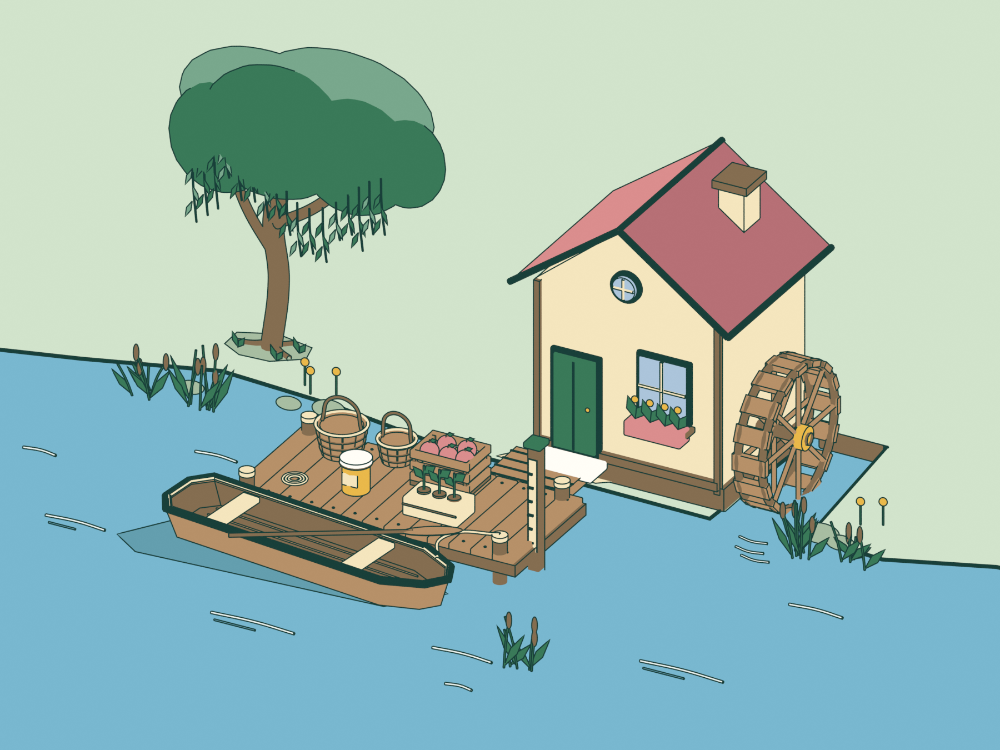

# Willowbank landing concept

Provisional Act III environment art for *After the Storm*, created with Sol 6.1
and Blender 4.3.2. The mill-side landing, moored punt, baskets, apples, honey,
seedlings and unnumbered flood post explore the existing
[Both Ways Across Willow Bridge brief](../../../docs/content/films-and-songs-2026-10-24.md#2-concept-art-brief-both-ways-across-willow-bridge).
This is a fictional environment study. It does not settle route geometry,
demonstrate a working mill or flood model, or clear final Act III production.



- `willowbank-landing-sol.png`: 1800 × 1350 concept illustration.
- `willowbank-landing-sol.blend`: editable scene with nine named art collections
  and local geometry and materials; no linked resources.
- `scene.py`: deterministic scene builder using Blender's bundled Python.

The curved riverbank, rose gable roof, broad punt and framing willow organize
the scene around the landing. Emission materials, orthographic framing and
selective ink contours follow the game's flat palette. Small details and line
weights still need adaptation for any eventual game surface.

## Rebuild

From the repository root:

```sh
blender --background --python design/concepts/willowbank-landing/scene.py
```

Append `-- --preview` for 60% resolution. The script replaces only this
directory's generated PNG and Blender scene. It uses Cycles with 32 samples,
Standard color management and no denoising. No downloads, textures, fonts or
add-ons are required. The saved scene uses a relative render output path; open
it in Blender and render to reproduce the image after making edits.

## Provenance and validation

Original procedural geometry and scene code, developed from the art brief
above and the existing [companion palette](../../../dist/companions.mjs),
[art specification](../../../docs/specs/20-number-garden-voice-and-art.md) and
social preview as design references. No external code, images or curriculum
content were incorporated. The repository's [MIT license](../../../LICENSE)
applies. No new learning capability or taxonomy mapping is introduced.

The Blender scene was reopened and rendered successfully at 1800 × 1350, and
the output was visually inspected. This asset is not loaded by the game;
final production and integration retain the owning brief's review gates.
