# Drawn how-to check for benches from specs 280 to 330

Backlog card LG-36, 2026-10-31. The 83 drawn how-tos (proposal: [drawn how-tos](../specs/proposed/drawn-how-to-animations.md)) predate the benches below. Each bench was opened on main at `36c1552` in a browser at 1024 px, and its heading, opening lines and visible buttons were read; `howtoForPage` returns none for every route listed. Captions use the buttons as they read on each bench's first screens; steps further in (for example plotting in Paired points) are drafted from the spec. None gives away an answer.

**Rule used.** A bench **needs one** when play has an order of moves the page does not show at a glance, or when the idea is the picture (a sweep, a nested part, a shared inside line). **Text is enough** when the page states the whole turn in a line or two, or the bench already has its own film.

**Not checked here:** the River Market (`#mercado`, 324 and 328) and Le bac (`#bac`, 327) are not on main yet; check them when #298, #314 and #302 land. The Endings Shelf (331) is not built. Older routes without one, outside this card's range: `#numbers/seeds/pairs`, `#science/water-shares`, `#post/descriptions`, `#post/sorting/order`.

## Needs one (15)

### Rhythm Studio (`#studio/rhythm`, spec 280, 300)

1. Choose a rhythm to work on. The others stay open.
2. Press Play the example to hear the rhythm you are matching.
3. Tap note and rest buttons to fill one bar of four beats.
4. Press Play my bar to hear what you built.
5. Press Compare with the example, then keep it or revise it.
- Side box *Bar too full?*: A bar holds four beats. Clear it, or choose shorter notes.

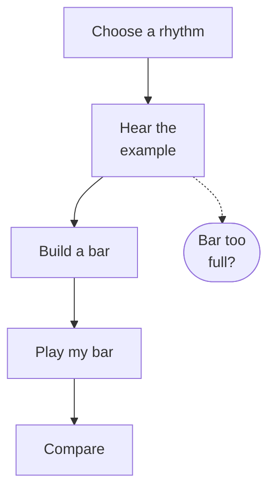

### Paired points (`#learn/math/paired`, spec 283)

1. Choose a chart of made-up courier records.
2. Press Start this chart to see the records.
3. Put each pair on the graph: blocks across, minutes up.
4. Look at the points together. What do they show?
5. Ask what the pattern can tell us, and what it can't.

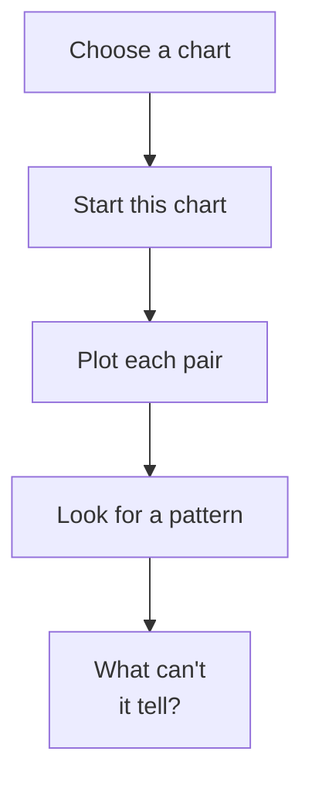

### Two Letters (`#post/register`, spec 284)

1. Choose a letter: to Nuria, or to the council.
2. Read who the reader is and what the letter must do.
3. Use Previous choice and Next choice, then Use these words.
4. Keep this page when the words suit this reader.
5. Write the other letter, then Read both to compare them.
- Side box *Not sure?*: Press I'm stuck to read the three teaching cards.

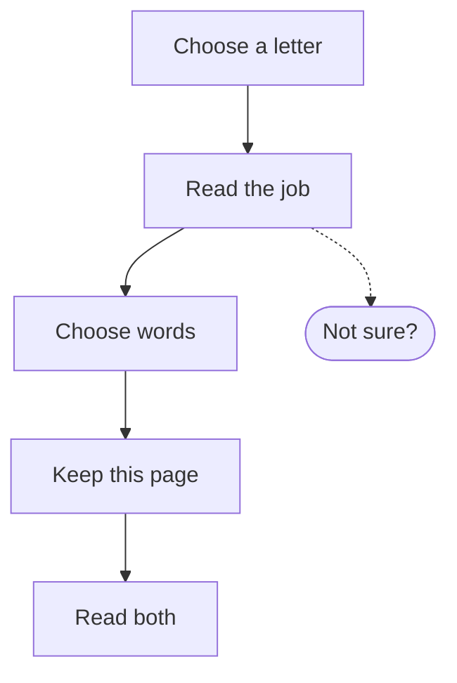

### The Mixing Table (`#studio/mixing`, spec 287)

1. Choose an invitation. Read the sample recipe.
2. Add or take back white and blue scoops.
3. Press Paint a stripe to see the color you made.
4. Compare your stripe with the sample. Same proportions, same color.
5. Change the scoops and paint again. Your first stripe stays in notes.
- Side box *Stuck?*: Show groups or Show a table to see the recipe in groups.

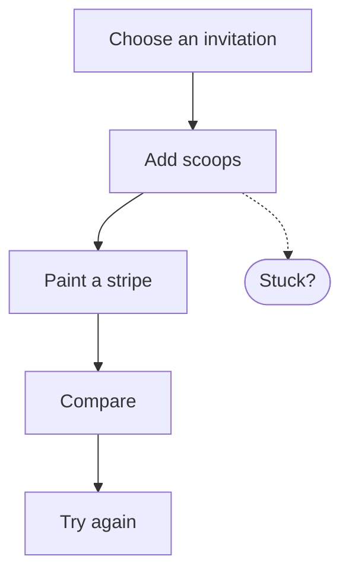

### Equal Blocks (`#studio/mixing/bars`, spec 288)

1. Choose an invitation. Read the total and the recipe.
2. Add or take back blocks for each color, in recipe order.
3. Choose how many scoops every block stands for.
4. Press Compare. Do the bars make the whole amount?
5. Change a bar or the block value, then compare again.

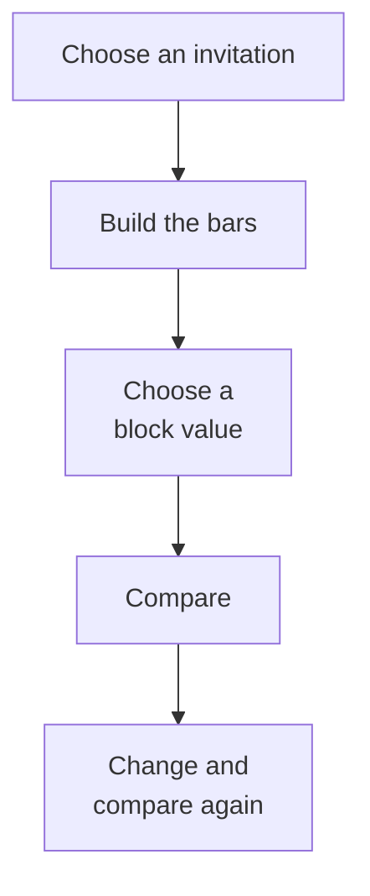

### Field Strips (`#studio/field-strips`, spec 290)

1. Open a field plan. The frame is always one whole field.
2. Add or remove strips to shade the first amount.
3. Add or remove rows to take part of that first amount.
4. Count the taken cells out of the whole field's cells.
5. Press Compare to check how much of the field you took.

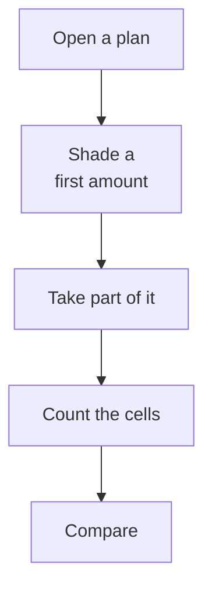

### Common Cuts (`#workshop/common-cuts`, spec 292)

1. Choose a pair of ribbons. Both use the same whole.
2. Change each ribbon's equal pieces. The colored ends stay still.
3. Keep changing until both ribbons have the same size pieces.
4. Now count each colored amount in the matching pieces.

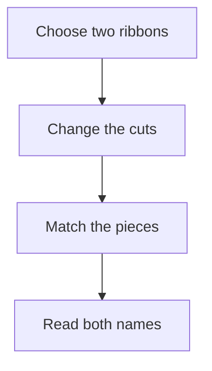

### Same ground, different fence (`#workshop/same-ground`, spec 293)

1. Choose how many tiles to use.
2. Lay one row at a time to make a plot.
3. Press Walk one edge until you have gone all the way round.
4. Keep this picture, then return the tiles.
5. Lay the same tiles another way. Does the fence change?
- Side box *Inside line?*: A line two tiles share is inside. It needs no fence.

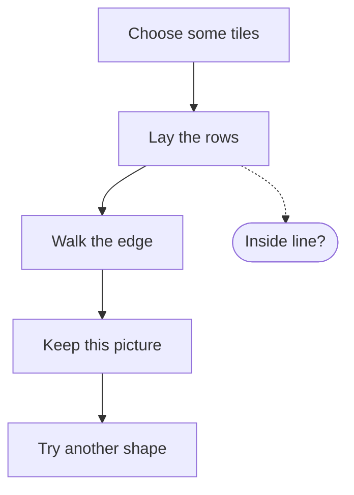

### Ribbon Measures (`#workshop/ribbon-measures`, spec 294)

1. Choose a ribbon to measure.
2. Lay measuring pieces end to end along the ribbon.
3. If a piece is too long, split each piece in 2 or 3.
4. Press Read the measurement to see how many groups cover it.
- Side box *Too far?*: Lift last piece, or Return all pieces, and try again.

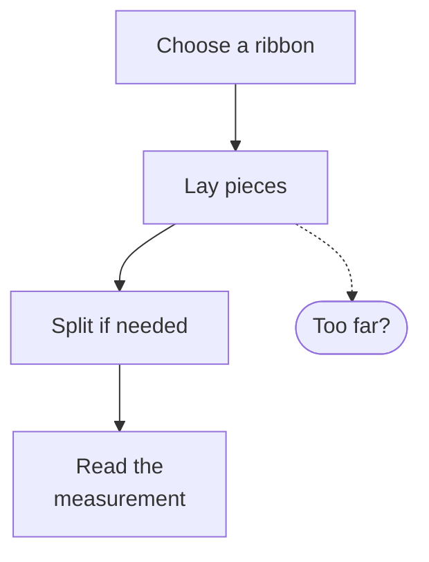

### Hinge Bench (`#workshop/hinge`, spec 297)

1. Choose a hinge case.
2. Turn more or turn back. Watch the marked sweep.
3. Change an arm's length. The turn stays the same.
4. Press Compare turns. The turn is the sweep, not the arm length.

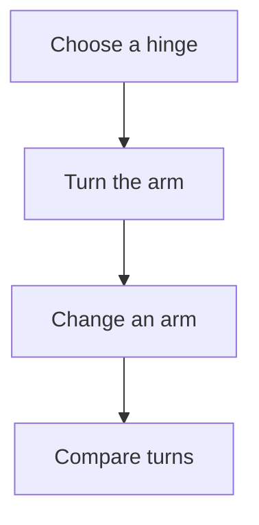

### Ferry Deck (`#post/ferry`, spec 298)

1. Choose a crossing to watch.
2. Press Forward one second, or Back one second.
3. Watch from bank, from ferry, or from the other boat.
4. Show readings to see each position from where you watch.
5. Press Explain this view. Same crossing, different starting point.

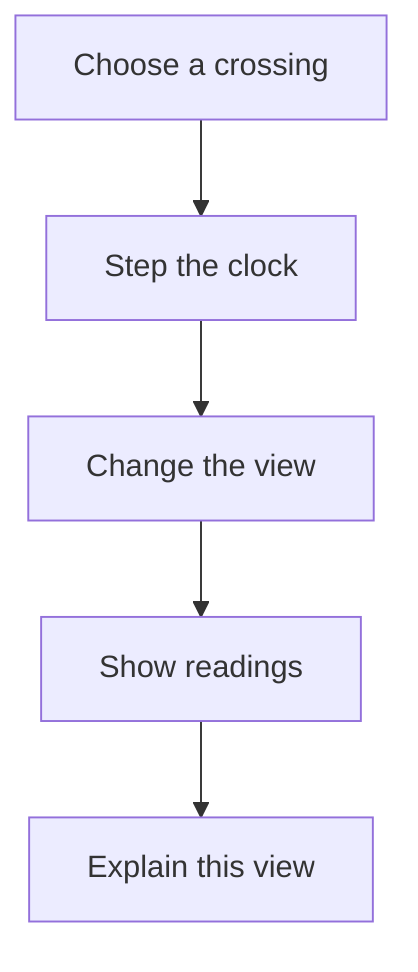

### The Mill's Energy Book (`#mill/energy`, spec 308)

1. Choose how many energy chips the high water has.
2. Pour one portion. Energy moves from high water to the wheel.
3. Grind one step to make flour.
4. Let it rub. Some energy becomes warmth.
5. Open the Energy book to see where every chip went.
- Side box *Close the gate*: Close the gate to stop pouring.

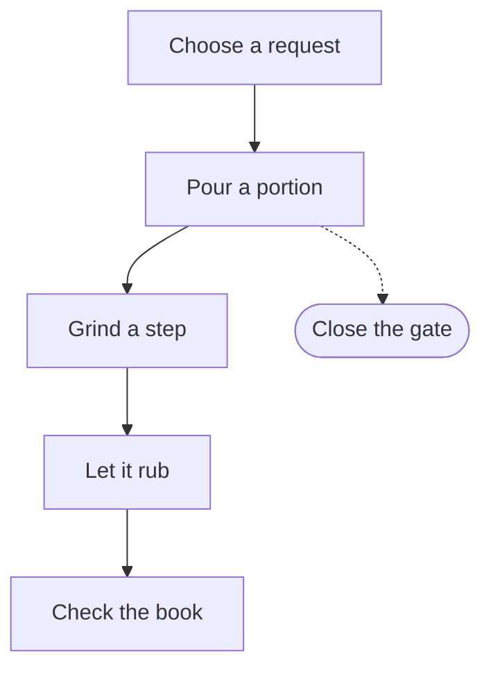

### The seed exchange table (`#desk/exchange`, spec 316)

1. Choose a card and press Start this card.
2. Add or lift whole trade groups.
3. Press Check these groups. Extra baskets stay at home.
4. Write what the courier should know.
5. Keep this card for the journey.

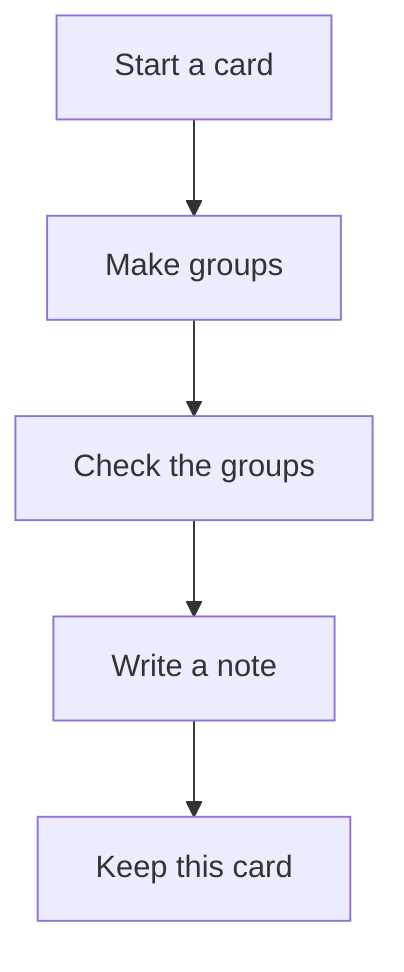

### Lantern Codes (`#post/codes`, spec 319)

1. Read about the lantern: a message and its pattern.
2. Make a short and long pattern for each message.
3. Send a message. See what Dot reads.
4. Compare codes. Which survives pretend rain?

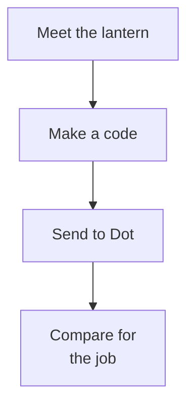

### Market Signs (`#words/signs`, spec 325)

1. Make a sign from a word and a prefix.
2. Open the dictionary to check your spelling.
3. Look at the guide words to find the right page.
4. Press Check this page.
5. Try a sign job with what you found.

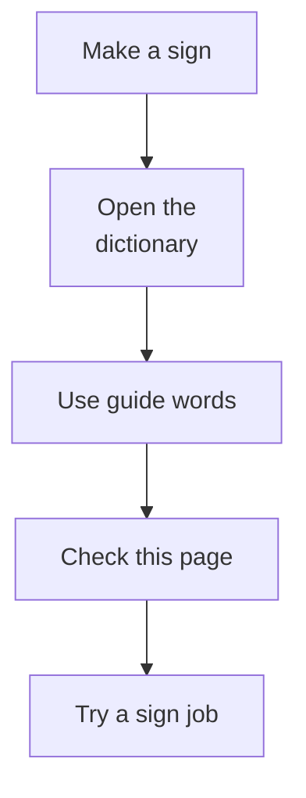

## Text is enough (16)

| Bench | Spec | Why |
| --- | --- | --- |
| Dot's weather notes (`#almanac/weather`) | 281 | One choice and Save today's note; the page says it in two lines. |
| Weather tallies (`#almanac/tallies`) | 281 | The opening line already says one mark per report, then count each row. |
| The Feeding Board (`#living/who-eats`) | 286 | The page's first line is the whole turn: look, choose a basket, check. |
| Between the Marks (`#desk/gaps`) | 289 | Two buttons and Compare; each invitation states its Start and Finish. |
| Upstream Post (`#almanac/upstream-reply`) | 291 | Open the letter, choose a question; no ordered play. |
| Copy Frame (`#workshop/copy-frame`) | 295 | Labeled width and height buttons and one stated rule; Show another example covers it. |
| Reading the old map (`#workshop/old-map`) | 296 | A reading and note page, not a bench. |
| Ice and warmth (`#science/ice`) | 301 | One pair of buttons, a text line per stage, and its own film. |
| The Switch Table (`#workshop/switch-table`) | 302 | One goal, a labeled switch button, Show path and its own film. |
| The Sound Window (`#studio/sound-window`) | 303 | The page states the move (hold one setting, change a control); its own film. |
| The Lift Yard (`#workshop/lift`) | 305 to 307 | Its 38-second film already shows a trip. |
| Parcel labels (`#words/endings`) | 314 | Choose an ending, check, keep; the page says so. |
| The Writing Table (`#desk/writing`) | 317, 321 | Each draft states its move (choose a strip, then its heading). |
| The Exchange Manifest (`#post/manifest`) | 319 | One mark per gap and Load it; Pip's loading is the feedback. |
| Word Workshop (`#words/props`) | 320 | A read-together page with its own steps on screen. |
| The Stained Map (`#library/spellings`) | 330 | Four tabs, each stating its job, with Show the next step. |

## Next

LG-37 builds the chosen how-tos with the existing authoring script, after a check of each caption against the page at build time. Each draft above is at most six steps, captions are second person and 15 words or fewer, and the side boxes follow the existing `more` aside pattern.
